# Veritabanı modeli

Bu ER diyagramı mevcut [SQLAlchemy modellerini](../backend/app/models.py) ve
[Alembic geçişlerini](../backend/migrations/versions/)
gösterir. Okunabilirlik için kullanıcı ve uzman tablolarında temel alanlar
seçilmiştir; diğer alanlar aşağıda açıklanır. Tablo adları kodla aynıdır.

[](diyagramlar/veritabani.svg)

Diyagrama tıklayarak tam boyutta açabilirsiniz. SVG yakınlaştırıldığında
netliğini korur. Koyu tema SVG'ye gömülüdür; görüntüleyicinin temasından bağımsızdır.
Düzenlenebilir kaynak: [veritabani.mmd](diyagramlar/veritabani.mmd).

## Diyagramı okuma

| Gösterim | Anlamı |
| --- | --- |
| `PK` | Birincil anahtar; satırı benzersiz tanımlar. |
| `FK` | Veritabanının denetlediği yabancı anahtar. |
| `UK` | Benzersizlik kısıtı. |
| `||` | Tam olarak bir kayıt. |
| `o|` | Sıfır veya bir kayıt. |
| `o{` | Sıfır veya daha fazla kayıt. |
| Kesik ilişki çizgisi | Yabancı anahtar, alt tablonun birincil anahtarının parçası değildir. |
| Düz ilişki çizgisi | Yabancı anahtar, alt tablonun birincil anahtarının parçasıdır. |

Kesik çizgi de gerçek bir yabancı anahtar ilişkisini gösterir. İlişkinin
isteğe bağlı olup olmadığını uçlardaki işaretler belirtir.

## İlişkiler ve kısıtlar

| İlişki | Veritabanındaki karşılığı |
| --- | --- |
| Kullanıcı → uzman | Bir kullanıcının en fazla bir uzman profili olabilir. Her uzman tam olarak bir kullanıcıya bağlıdır; `uzmanlar.kullanici_id` zorunlu ve benzersizdir. |
| Kullanıcı → oturum | Kullanıcının sıfır veya çok sayıda oturumu olabilir. Her oturum tam olarak bir kullanıcıya bağlıdır. |
| Uzman → randevu | Uzmanın sıfır veya çok sayıda randevusu olabilir. Her randevu tam olarak bir uzmana bağlıdır. |
| Uzman → tavsiye | Her tavsiyenin öneren ve önerilen uzmanı vardır. İki FK de `uzmanlar.id` alanını gösterir. `(veren_id, alan_id)` birleşik birincil anahtardır; aynı meslektaş bir profilde yalnız bir kez önerilebilir. Öneri, profil sahibinin çalışmadığı ve hedef terapistin çalıştığı `uzmanlik` alanına bağlıdır. |
| Uzman → doğrulama | Her uzmanın en fazla bir güncel `therapist_verifications` kaydı vardır. `uzmanlar.onayli` mevcut yayın kontrolü olarak korunur; yönetici onayı iki alanı aynı işlemde günceller. |
| Uzman → davet | `invitations.davet_eden_uzman_id` daveti oluşturan doğrulanmış uzmanı, kabulden sonra `kabul_eden_uzman_id` yeni uzmanı gösterir. `iliski_turu` sonraki professional graph geçişi için `invited_to_platform` değerini taşır. |
| Uzman → kurucu üyelik | Bir uzmana en fazla bir kalıcı kurucu numarası atanabilir; `kurucu_no` platform genelinde benzersizdir. |
| Kullanıcı → kurucu programı ayarı | Tekil `founding_program_settings` satırı maksimum kurucu sayısını tutar; son güncelleyen yönetici isteğe bağlı FK alanıyla izlenir. |
| Uzman → profesyonel bağlantı | Her bağlantı isteğinde isteyen ve alıcı uzman ayrı FK alanlarında tutulur. Kabul edilen bağlantı iki profil için de aynı kayıttır; istek yönü yalnız rıza kararının sahibini belirler. |
| İlişki türü → profesyonel bağlantı | `professional_connections.iliski_turu` kontrollü kataloğun `slug` alanına bağlıdır. Kullanıcının seçebildiği altı türün yanında davet kabulünden üretilen, seçilemeyen `invited_to_platform` türü bulunur. |
| Uzman → danışan yönlendirmesi | Her `client_referrals` kaydı bağlantıyı oluşturan doğrulanmış uzmana bağlıdır. Ham token yerine yalnız SHA-256 özeti tutulur. |
| Yönlendirme → hedef terapist | `referral_targets`, bir yönlendirmede gösterilecek bir ila üç doğrulanmış uzmanı ve sırasını birleşik anahtarla tutar. |
| Yönlendirme → olay | `referral_events`, oluşturma, anonim açılma ve hedef profil tıklaması olaylarını tutar. Profil tıklamasında hedef uzman FK'sı bulunur; ziyaretçi kimliği, IP adresi veya sağlık verisi saklanmaz. |
| Uzman → website rozeti | Doğrulanmış bir uzmanın en fazla bir `website_badges` kaydı olabilir. Rozet kimliği dış siteye verilen embed kodunda kullanılır. |
| Website rozeti → olay | `website_badge_events`, yalnız `badge_created` ve `badge_clicked` olaylarını tutar; ziyaretçi kimliği, IP adresi veya kullanıcı aracısı saklanmaz. |
| Uzman → meslektaş uzmanlık ilişkisi | Her `peer_specialty_associations` kaydında ilişkilendiren ve hedef uzman ayrı FK alanlarıdır. Aynı meslektaş, aynı hedef ve uzmanlık için yalnız bir kez sayılır. |
| Denetim | `kullanici_id` ve `kaynak_id` isteğe bağlı metin referanslarıdır; FK kısıtları yoktur. Bu nedenle diyagramda başka bir tabloya ilişki çizilmez. |

`uq_aktif_randevu` kısmi benzersiz indeksi, aynı `(uzman_id, baslangic)` çifti
için `bekliyor` veya `onaylandi` durumunda en fazla bir randevuya izin verir.
Bu, bütün randevu durumlarına uygulanan genel bir benzersizlik kuralı değildir.

`uq_aktif_davet_email` kısmi benzersiz indeksi aynı e-posta adresi için
`pending` veya `accepted` durumunda yalnız bir davete izin verir. Süresi dolan
davetler yeni davet oluşturulmadan önce `expired` durumuna geçirilir. Kabul
anahtarının kendisi değil yalnız SHA-256 özeti saklanır; ham değer yalnız davet
oluşturma yanıtında gösterilir.

`professional_connections.cift_anahtari`, iki uzman kimliğinin sıralanmış
birleşimidir ve benzersizdir. Böylece aynı iki uzman arasında ters yönden ikinci
bir istek açılamaz. Durum `pending`, `accepted`, `rejected` veya `revoked`
olabilir; yalnız `accepted` kayıtlar herkese açık profillerde gösterilir. Talebi
yalnız alıcı uzman kabul veya reddedebilir. Reddedilen kayıt, rıza kararının ve
tekrar istek engelinin korunması için silinmez.

`client_referrals.neden` yalnız kontrollü bir yönlendirme kategorisidir; serbest
metin veya danışan bilgisi değildir. Bağlantı 90 gün geçerlidir. Ham token
yalnız oluşturma yanıtında gösterilir ve veritabanına yazılmaz. Açık sayfa
yönlendirme nedenini de paylaşmaz.

`peer_specialty_associations` yalnız hedef profilin yayımladığı uzmanlıkları
kabul eder; yayımlanmış terapi yaklaşımları da çalışma alanı olarak seçilebilir.
Profesyonel bağlam birlikte çalışma, aynı eğitim programı, süpervizyon,
iki yönlü danışan yönlendirme veya profesyonel çalışmaları takip etme
seçeneklerinden biridir ve açık profilde gösterilmez. Serbest yorum ya da
testimonial alanı yoktur. Toplamlar puan, sıralama veya kalite metriği değildir;
doğrulaması ya da profil yayını kalkan katkıda bulunanlar açık toplamdan çıkarılır.

`uzmanlar.kullanici_adi`, `/passport/{kullanici_adi}` adresinde kullanılan
benzersiz ve kalıcı URL parçasıdır. Yeni hesaplarda terapistin adından üretilir;
çakışmada sayısal ek alır. `uye_olma` Unix saniyesi olarak sunucu tarafında
atanır. Geçiş sırasında mevcut profillerin üyelik tarihi, varsa doğrulama
başvurusunun `gonderilme` zamanından korunur.

`founding_program_settings` yalnız `id=1` olan tek satırı kabul eder. Doğrulama
tamamlandığında bu satır kilitlenir; kurucu numarası en son numaranın bir
fazlası olarak ve `azami_uye` sınırına kadar atanır. Kapasite artırıldığında
daha önce doğrulanmış fakat kontenjan dışında kalmış profiller doğrulama
zamanına göre sıraya alınır. Atanmış son numaranın altına limit indirilemez.
`founding_members` üzerindeki migration trigger'ları uzman/numara güncellemesini
ve satır silmeyi reddeder; numaralar tekrar kullanılamaz. Arşivleme veya geçici
yayından kaldırma kurucu kimliğini silmez.

`website_badges` bir terapist için tekil ve kalıcıdır. Public SVG yalnız profil
yayında ve mesleki doğrulaması geçerliyken sunulur. Embed bağlantısı önce
`badge_clicked` olayını kaydeder, ardından terapistin pasaportuna yönlendirir.
Olay tablosunda ziyaretçiyi tanımlayan veya parmak izi çıkaran alan bulunmaz.

`client_referrals.view_count`, yalnız geçerli yönlendirme sayfası başarıyla
oluşturulduğunda atomik olarak artırılır. Süresi dolmuş, iptal edilmiş veya
gösterilebilir hedefi kalmamış bağlantılar sayılmaz. `referral_events` sonraki
ürün analizleri için olay türünü ve varsa hedef terapisti tutar; danışan
kimliği, iletişim bilgisi, terapiye başlama/sonuç bilgisi, IP adresi veya
kullanıcı aracısı saklamaz. Ham yönlendirme tokenı da yalnız oluşturma
yanıtında bulunur; veritabanında SHA-256 özeti tutulur.

## Alanların kapsamı

| Tablo | Saklanan bilgiler |
| --- | --- |
| `kullanicilar` | Kimlik, benzersiz e-posta, parola özeti, rol, etkinlik ve şifreli MFA sırrı. Diyagramda gösterilmeyen `son_mfa_adimi`, aynı TOTP adımının tekrar kullanımını denetler. |
| `uzmanlar` | Kullanıcı bağlantısı, benzersiz pasaport kullanıcı adı, üyelik zamanı, profil, yayın durumu ve kişiye özel davet limiti. Diyagramda gösterilmeyen metin/sayı alanları: `ilce`, `biyografi`, `deneyim_yili`, `adres`. Ek JSON alanları: `ekoller`, `kitle`, `formatlar`, `uzmanliklar`, `egitim`, `kurumlar`. |
| `oturumlar` | Ham oturum belirteci yerine özeti, kullanıcı bağlantısı, CSRF özeti ve zamanlar. |
| `randevular` | Uzman bağlantısı, başlangıç zamanı, şifreli danışan adı/telefonu, durum, oluşturma zamanı ve aydınlatma metninin sürümü. |
| `tavsiyeler` | Profil sahibinin çalışmadığı bir uzmanlık alanı, o alanda önerdiği doğrulanmış terapist ve oluşturulma zamanı. Eski genel tavsiyeler migration sırasında `Genel yönlendirme` etiketiyle korunur. |
| `therapist_verifications` | Uzmanın bekleyen, doğrulanmış veya reddedilmiş mesleki doğrulama durumu ile yönetici inceleme zamanı. |
| `invitations` | Davet eden uzman, normalize e-posta, isteğe bağlı ad, token özeti, süre/durum ve kabul eden uzman bağlantısı. |
| `founding_members` | Değişmeyen kurucu numarası, uzman, atayan yönetici ve atanma zamanı. |
| `founding_program_settings` | Tekil program ayarı; maksimum kurucu sayısı, son güncelleme zamanı ve isteğe bağlı güncelleyen yönetici. |
| `connection_relationship_types` | İlişkinin sabit anahtarı, Türkçe etiketi, seçilebilirlik/aktiflik durumu ve arayüz sırası. |
| `professional_connections` | İsteyen ve alıcı uzman, yön bağımsız çift anahtarı, ilişki türü, rıza durumu ile istek/yanıt zamanları. |
| `client_referrals` | Oluşturan uzman, token özeti, kontrollü neden, durum, oluşturma/sona erme zamanı ve anonim `view_count`. Danışana ait alan içermez. |
| `referral_targets` | Yönlendirme bağlantısında gösterilecek uzmanlar ve gösterim sırası. |
| `referral_events` | `referral_created`, `referral_opened` ve `profile_clicked_from_referral` olayları; yönlendirme, isteğe bağlı hedef uzman ve zaman. |
| `website_badges` | Uzmanın tekil rozet kimliği ve oluşturulma zamanı. |
| `website_badge_events` | Rozet bağlantısı, `badge_created` veya `badge_clicked` olay türü ve zaman. |
| `peer_specialty_associations` | İlişkilendiren ve hedef uzman, hedefin uzmanlık alanı, kontrollü profesyonel bağlam ile oluşturma/güncelleme zamanı. |
| `denetim` | İşlem türü, zaman ve isteğe bağlı kullanıcı/kaynak referansları. |

`id` alanları UUID değerlerini metin olarak tutar; oturumların anahtarı
belirteç özetidir. JSON alanları ayrı ilişkisel tablolar değildir.
Zaman alanları Unix saniye olarak tutulur; randevu gösterimi Türkiye saatine göre yapılır.

Ayrı bir `danisanlar` tablosu yoktur: randevu formundaki ad ve telefon,
`randevular.danisan_sifreli` içinde şifreli olarak saklanır. Diyagramda veri
değerleri veya gerçek danışan bilgileri bulunmaz.

## Diyagramı güncelleme

Şema değiştiğinde Mermaid kaynağını ve bu açıklamaları birlikte güncelleyin.
Proje kökünde aşağıdaki komut SVG'yi yeniden üretir; ilk kullanımda çizim aracı
ve tarayıcı bileşenleri indirilir. Bu araç uygulamayı çalıştırmak için gerekmez.

```bash
npm exec --yes --package=@mermaid-js/mermaid-cli@11.17.0 -- mmdc -i docs/diyagramlar/veritabani.mmd -o docs/diyagramlar/veritabani.svg -b '#0b1220'
```
